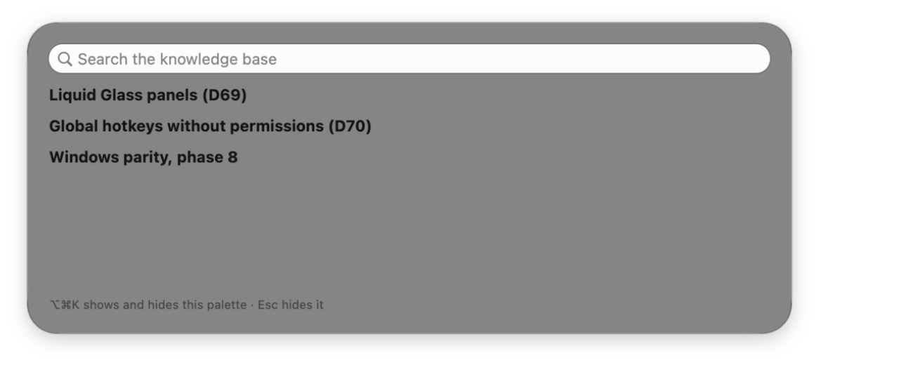
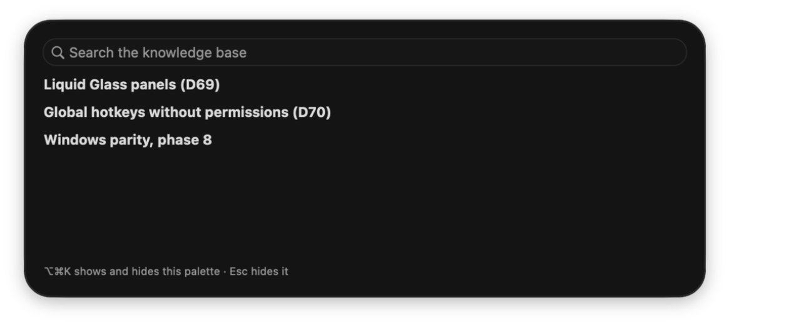

# Phase 8 measurements on macOS

The plan's budgets (docs/PHASE8-PLAN.md, "Budgets") name the MacBook as the reference machine. Numbers here carry the machine they were taken on.

**Machines:**
- **Mac mini** (M4, macOS 27.2 26B5101f, LG UltraGear 5K at 2× and 120 Hz). Shared with other agent sessions: their test runs kept the load average between 40 and 120 on its 10 cores during these runs, so timings are upper bounds. The session was locked with the display kept awake (`caffeinate -d -u`): windows draw and the display link ticks, but the app cannot become active.

## W2 panels and W7 hotkeys (2026-10-27)

`cmd/paneldemo -measure 100 -keep`: a palette panel (Floating, Shadow, Radius 26, Liquid Glass backdrop, 640 × 260 pt) registered on ⌥⌘K. Each press is a synthetic `kEventHotKeyPressed` sent through Carbon's own handler (`hotkey.Simulate`), which delivers the `EvService` that the app answers with `Win.Show`. The press is timed to the first build after it and to that frame's present feedback (Metal's presented handler, `gpu.Surface.TraceNextPresent`). The panel is hidden between presses, and the first press, which starts the panel's display link, is not counted. `-keep` turns off HideOnDeactivate: in a locked session the app never becomes active, and AppKit keeps a hidesOnDeactivate panel of an inactive app off screen, where its present feedback would come without compositing.

| Metric | Budget | Result | Machine |
|---|---|---|---|
| Hotkey → panel on glass, warm | ≤ 50 ms (MacBook) | glass: median **11.4 ms**, p95 **37.5 ms**, max 164 ms (100 presses, load 52–87); median 14.5, p95 55.2, max 152 (load 42–122). Drawn shape without glass: median 15.7, p95 35.6, max 59.3 | Mac mini, loaded |
| Hotkey → first build after Show | (part of the above) | median **5.1 ms**, p95 15.9, max 44.5 (load 52–87) | Mac mini, loaded |
| Panel shows within 1 frame of Show | 1 frame | the frame after the press was built with no display tick in between in 58 of 100 presses, after 1 tick in 42 (glass, load 52–87); 34/65/1 for 0/1/2 ticks in the more loaded run. At 120 Hz a tick is 8.3 ms. Show orders the panel in with its last frame on the same turn | Mac mini, loaded |
| A hotkey press, in the app | 0 allocations | **0 Go allocations** a press over 1,000 presses; about 2.1 µs a press, handler and delivery to `Handler.Event` | Mac mini (`TestLiveHotkeys`) |
| 100 Show/Hide pairs | leak nothing | window, view, delegate, host and material counts unchanged; **0 Go allocations** at the platform level | Mac mini (`TestPanelShowHideLeaksNothing`, `TestPanelShowHideKeepsStateAndBuildsNothingHidden`) |
| A hidden panel builds | 0 | **0 builds** over 40 wakes while hidden | Mac mini (the same app test) |

The two glass runs differ only in the load the other sessions put on the machine; the spread above the median is scheduling. Unloaded numbers, and the MacBook's, are still to be taken.

### Captures

The palette on Liquid Glass, captured with GnuiShot (`shot.sh window -shadow`) from `paneldemo -mode light -keep` and `-mode dark -keep`:

A single-window capture shows the glass with nothing behind it, so it reads as flat grey. With the session locked, a composited capture of the display region would show the lock screen behind the panel, so the glass over real content needs an unlocked session. The recording bar (ExcludeFromCapture: `sharingType` none) could not be captured at all: ScreenCaptureKit refused the stream ("Failed to start stream due to audio/video capture failure") in light and dark, while the palette next to it was captured. That refusal is the exclusion working.
